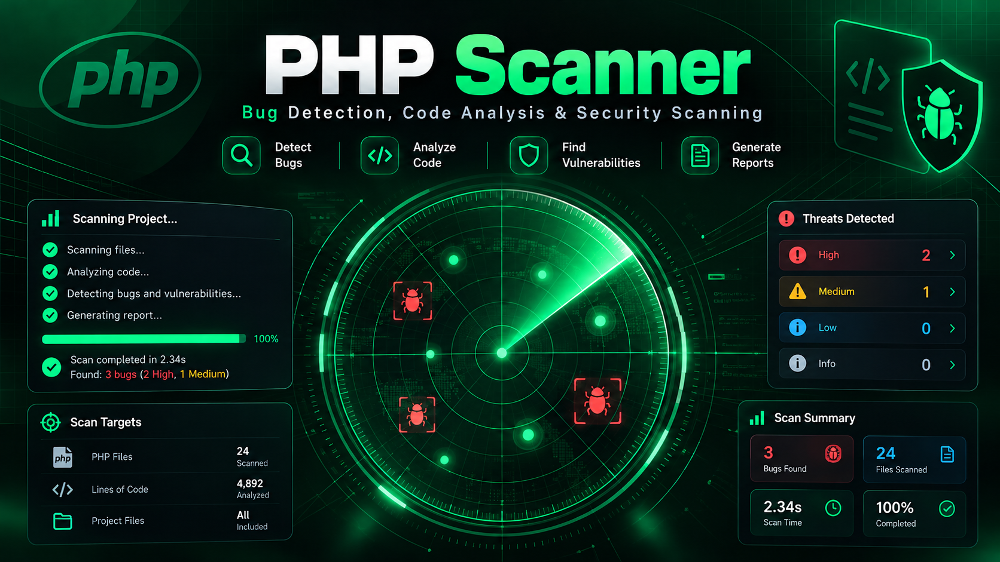

<div align="center">

# ⚡ php-scanner

### find the bugs → let Claude + Codex prove them live

`scan → static rules → AI triage → multi-agent live pentest`



</div>

---

Three stages, one pipeline, zero tokens burned in your coding session:

1. **`scanner.php`** — dependency-free PHP static analyzer. ~30 rules covering the bugs that actually pop small sites: SQLi, XSS, command injection, LFI/RFI, deserialization, open redirect, mail header injection, weak crypto, hardcoded creds, debug leftovers.
2. **`triage.cjs`** — sends raw findings to a side AI (local Ollama stack if you have one, otherwise the `claude` CLI) to kill false positives and rank real, exploitable bugs.
3. **`pentest.cjs`** — dispatches the confirmed bugs to multiple agents (Claude + Codex CLI) that run harmless curl proofs against the **live** URL and report CONFIRMED / UNCONFIRMED with evidence.

## Install

```
git clone https://github.com/hangryclaude/php-scanner
```

Requires: `php` (8+), `node` (18+), and for the AI stages `claude` and/or `codex` CLIs logged in.
Static scan alone needs nothing but PHP.

## Usage

```bash
# 1. Static scan (console report, exit 1 on findings)
php scanner.php /var/www/mysite

# JSON output + severity floor
php scanner.php /var/www/mysite --json --min-severity=medium
```

**Running it from Claude Code or Codex?** This repo ships with pre-loaded agent prompts:
- Claude Code: `/scan <path>` and `/pentest <path> <url>` slash commands (`.claude/commands/`) + `CLAUDE.md`
- Codex: `AGENTS.md` is auto-read, and copy-paste prompts live in [`prompts/`](prompts/README.md)

Just open the repo in your agent and say "scan this site".

```bash
# 2. AI triage of findings
php scanner.php /var/www/mysite --json | node triage.cjs

# 3. Live pentest: serve the site, then let Claude + Codex attack it
php -S 127.0.0.1:8899 -t /var/www/mysite &
php scanner.php /var/www/mysite --json | node pentest.cjs http://127.0.0.1:8899

# Single agent only
php scanner.php /var/www/mysite --json | node pentest.cjs http://127.0.0.1:8899 --agents=claude

# Claude CLI pointed at a proxy / local model? Pin a model id it accepts.
PENTEST_CLAUDE_MODEL=claude-sonnet-4-6 ... node pentest.cjs http://127.0.0.1:8899
```

If the pinned model is rejected as unknown, `pentest.cjs` retries with the CLI's
own default rather than failing the run.

Or everything local: `./scan.sh /var/www/mysite`.

## Live mode: no source, just a URL

The static rules need a filesystem path. When all you have is a URL, the pipeline
runs *probe → pentest* instead of *scan → triage → pentest*:

```bash
# deterministic, zero-token recon: reflection, SQL errors, traversal, redirect
node probe.cjs https://example.com/product.php?id=1

# harvest ~100 live PHP URLs (urlscan.io public search, no API key) and verify each
node discover.cjs --count=100 --out=targets.jsonl

# run the whole thing over the list, resumable via ledger.jsonl
node run-all.cjs --agents=claude,codex,grok
```

`probe.cjs` only produces **candidates** — a raw reflection, a database error, a
`/etc/passwd` read, an attacker-controlled `Location`. The agents in `pentest.cjs`
still have to reproduce each one with their own curl before it counts as confirmed.
`run-all.cjs` writes `ledger.jsonl` (one record per site) and `reports/*.md`, so a
crash or ctrl-c resumes where it stopped; pass `--recheck` to redo a site.

Probes are deliberately gentle: one request per hypothesis, 350ms apart, GET/POST
only, no auth bypass, no destructive payloads, UA identifies the tool. Use it
against sites you're allowed to poke.


## Try it on the sample site

```
php -S 127.0.0.1:8899 -t testsite &
php scanner.php testsite --json | node pentest.cjs http://127.0.0.1:8899
```

`testsite/` is deliberately vulnerable (XSS, LFI, RCE via shell_exec, unserialize, open redirect, hardcoded creds) and needs no database.

## Rules

| Family | IDs | What it catches |
|---|---|---|
| SQLi | SQLI.001–003 | interpolated queries, concat-built queries, raw input in SQL |
| XSS | XSS.001–004 | unescaped echo/print/short-echo of superglobals |
| Command injection | CMD.001–003 | system/exec/shell_exec with input, backticks, eval |
| File | FILE.001–003 | include/require from input (LFI/RFI), path traversal |
| Deserialization | DESER.001 | unserialize on user input |
| Uploads | UPLOAD.001–002 | $_FILES handling, move_uploaded_file |
| Credentials | CRED.001–003 | hardcoded DB passwords, API keys/tokens |
| Redirect / mail | REDIR.001, MAIL.001 | open redirect, header injection |
| Crypto / logic | CRYPTO.001–002, AUTH.001, LOGIC.001 | md5/sha1, mt_rand, loose secret compare, `=` in if |
| Config / debug | DEBUG.001–002, MISC.001–003, SSRF.001 | var_dump, display_errors, extract, preg /e, $_REQUEST, SSRF |
| Info disclosure | INFO.001–005 | phpinfo(), XXE, header injection, version disclosure, backup files (`*.bak`) |

Each finding ships with a fix hint. Rules are plain regex entries at the top of `scanner.php` — add your own in seconds.

### The big one: PHP2Shell (CVE-2026-109618 / CVE-2026-109619)

Unauthenticated RCE in **PHP itself** (CVSS 9.2), exploited in the wild since Oct 21 2026 via `session.upload_progress` multipart requests — no app-code bug needed. The scanner flags **unpatched runtimes** three ways:

- `--php-version=8.4.26` — check a known version
- repo hints — `composer.json`, `Dockerfile FROM php:x.y`, `.php-version`, `.tool-versions`
- live sniff — `pentest.cjs` reads the site's `X-Powered-By` header and adds the finding only when the runtime is **older than the patched releases** (8.2.35 / 8.3.36 / 8.4.27 / 8.5.12); patched sites are explicitly skipped so you find the sites where *the bug is still there*.

## Pentest safety

Agents are instructed to use harmless echo/alert-style payloads only — no deletion, no defacement, no destructive SQL. Each agent's full report is saved to `$TMPDIR/pentest/<agent>-report.md`.

## Exit codes

- `0` clean, `1` findings at/above `--min-severity`, `2` usage error — CI friendly.

## Legal

Only scan and pentest sites you own or are authorized to test.

## License

[MIT](LICENSE) — © 2026 hangryclaude
